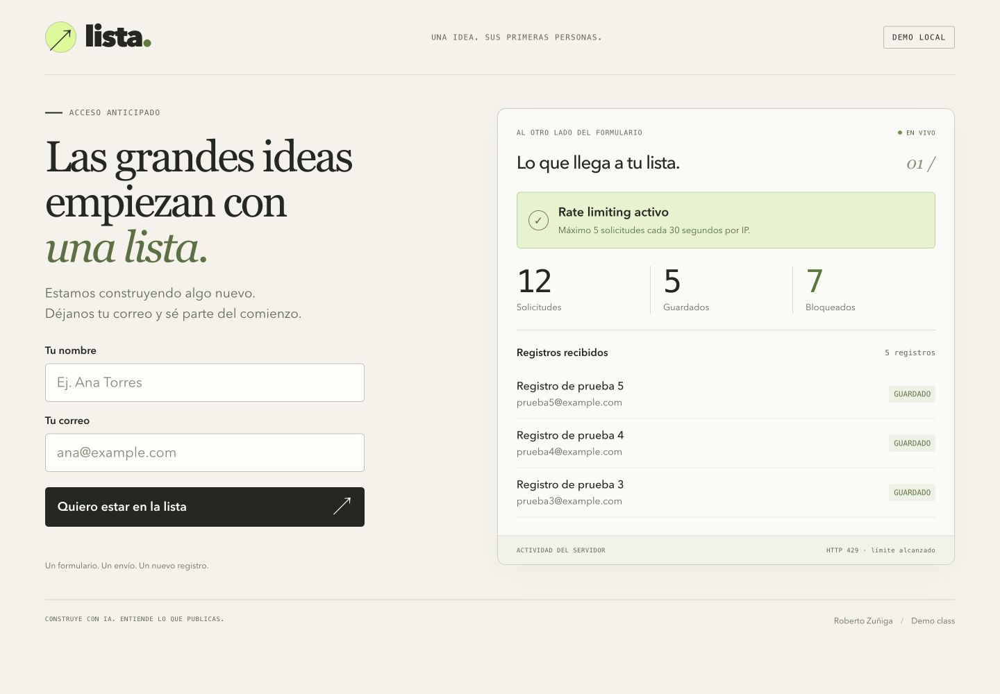

# Una lista, doce solicitudes y un límite

Demo práctica para la clase **Cómo evitar que tus apps creadas con IA sean hackeadas**. El objetivo concreto es reducir envíos automatizados a un formulario mediante rate limiting en el servidor.

## Arrancar en un minuto

Requisito: Node.js 22 o superior. No necesitas instalar paquetes ni crear cuentas.

```bash
git clone https://github.com/Robertzu43/platzi-demo-rate-limiting.git
cd platzi-demo-rate-limiting
npm start
```

Abre **http://127.0.0.1:4173** en un navegador de escritorio. Deja esa terminal abierta.

En una segunda terminal, entra en la misma carpeta:

```bash
# 1. Preparar el antes: vacía todo y desactiva el control.
npm run demo:antes

# 2. La misma prueba que verás en la clase: doce envíos locales.
npm run demo:enviar
# Resultado: 12 guardados / 0 bloqueados.

# 3. Preparar el después: activa el control y reinicia la cuota.
npm run demo:despues

# 4. Repetir exactamente la misma prueba.
npm run demo:enviar
# Resultado: 5 guardados / 7 bloqueados con HTTP 429.
```

El panel del navegador se actualiza solo. No hay respuestas simuladas: el script y el formulario usan `POST /api/registro`; el servidor decide si guarda o rechaza.

## Para grabar hoy

- [Guion completo, con tiempos y acciones](GUION.md)
- [Tarjeta breve de grabación](GRABAR.md)
- [Implementación del límite](src/rate-limit.js)
- [Ruta que recibe y guarda registros](src/registro.js)
- [Archivo que envía los doce registros](scripts/enviar-registros.js)

La implementación está preparada para explicarla y activarla durante la toma. No hace falta escribir todo el servidor en vivo. Los comandos de escenas son controles del laboratorio: **no son una función que expondrías a usuarios de una app real**.

## Comandos de ensayo

| Comando | Efecto |
|---|---|
| `npm start` | Inicia en modo sin protección, en `127.0.0.1:4173`. |
| `npm run demo:antes` | Desactiva protección; limpia registros, métricas y cuota. |
| `npm run demo:despues` | Activa protección; limpia registros, métricas y cuota. |
| `npm run demo:limpiar` | Conserva el modo, pero reinicia registros, métricas y cuota. |
| `npm run demo:enviar` | Envía exactamente doce registros ficticios, secuencialmente. |
| `npm run demo:estado` | Muestra el modo y los contadores actuales. |
| `npm test` | Ejecuta pruebas reales de la API y del limitador. |

**Antes de cada lote**, reinicia la escena o ejecuta `demo:limpiar`. Un envío manual también consume cuota. El script avisa cuando hay solicitudes anteriores, pero no las borra por su cuenta.

Si esperas treinta segundos después de la primera solicitud de una ventana, el mismo cliente recupera su cuota. Los bloqueos no prolongan la ventana. Las métricas muestran los totales desde el último reinicio, no solo la ventana actual. Se conservan los últimos 500 registros del ensayo.

## Qué enseñar en el editor

1. `public/app.js`: el `fetch('/api/registro', ...)` del formulario.
2. `scripts/enviar-registros.js`: el bucle realiza el mismo POST doce veces.
3. `src/registro.js`: primero se comprueba el límite; después se valida y guarda.
4. `src/rate-limit.js`: IP, contador, vencimiento y decisión.

Abre los archivos antes de grabar. Oculta el explorador del editor si ocupa espacio y usa letra de 20–24 puntos. No recorras los archivos de infraestructura durante la clase.

## Alcance técnico

- Ventana fija por cliente: cinco solicitudes durante treinta segundos desde el inicio de su ventana. Es una cuota de demostración, no una recomendación universal.
- Se usa la IP del socket. Se ignora `X-Forwarded-For`; un cliente no puede inventar su propia cuota enviando esa cabecera. No se ha configurado un proxy inverso.
- El límite se revisa antes de leer y guardar el formulario. Los intentos inválidos también consumen cuota cuando el control está activo.
- `429` incluye `Retry-After`, con los segundos restantes.
- Los registros y contadores viven en memoria de un único proceso. Reiniciar el servidor los borra. Para múltiples instancias se necesitarían contadores compartidos y operaciones atómicas, o un servicio de rate limiting.
- Distintos usuarios pueden compartir IP; un cliente distribuido puede usar varias. Rate limiting no autentica usuarios, no verifica correos y no garantiza detener un DDoS.
- El historial es visible en esta web porque es un laboratorio. En producción, la lista de leads debería vivir en una vista administrativa con autorización.
- El servidor solo escucha en loopback. El script no permite elegir una URL externa. No se despliega esta demo como formulario público.

El control local de escenas requiere un token que el servidor guarda en `.demo-session.json` con permisos de lectura/escritura del propietario. Está excluido de Git. El navegador no recibe ese token.

## Si algo falla

**Puerto ocupado:** cierra otra instancia, o arranca con `PORT=4174 npm start`. Abre el puerto que indique la terminal; los scripts lo leen automáticamente. Usa una sola instancia por carpeta.

**No conecta:** inicia `npm start` y mantenlo abierto. Si reiniciaste el servidor, vuelve a preparar la escena.

**No aparece 5/7:** ejecuta `npm run demo:despues` y luego `npm run demo:enviar`, sin hacer envíos manuales entre ambos.

**La pantalla solo muestra una columna:** el panel de Codex es estrecho. Abre la URL en una ventana completa de tu navegador. La interfaz se adapta al ancho; para grabar conviene mostrar formulario y registros lado a lado.

## Referencias

- [OWASP: REST Security Cheat Sheet](https://cheatsheetseries.owasp.org/cheatsheets/REST_Security_Cheat_Sheet.html)
- [MDN: HTTP 429](https://developer.mozilla.org/en-US/docs/Web/HTTP/Reference/Status/429)

Repositorio: [Robertzu43/platzi-demo-rate-limiting](https://github.com/Robertzu43/platzi-demo-rate-limiting).

## Vista de la prueba


